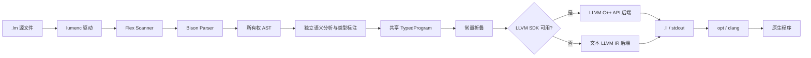

# Lumen C 架构设计

## 1. 文档目的

本文描述 Lumen C 编译器的系统边界、模块划分、数据流、关键架构决策和质量策略。
语法、AST 节点、作用域与 LLVM 指令的逐项映射见
[详细设计](detailed-design.md)。

## 2. 设计目标

Lumen C 是一个小型但端到端完整的 C 风格编译器，目标是展示真实编译器工程中的
核心链路，而不是只计算表达式：

1. 使用 Flex 完成词法分析，Bison 完成 LALR(1) 语法分析。
2. 构建具有明确所有权的 AST，使前端与后端解耦。
3. 完成名字解析、作用域、函数签名等基础语义检查。
4. 生成经过验证、可继续优化和链接的 LLVM IR。
5. 对语法错误、语义错误和坏 IR 尽早失败，并给出源码行号。
6. 同一套端到端测试同时约束 LLVM API 后端和兼容文本 IR 后端。

非目标包括完整兼容 ISO C、预处理器、调试信息、对象文件直接生成和结构体类型系统。

## 3. 系统上下文



编译器进程以单个源文件为输入，以 LLVM IR 为输出。链接系统库、选择目标平台和生成
最终可执行文件由 `clang` 完成，因而编译器本身不复制 LLVM 的目标机和链接器职责。

## 4. 分层结构

| 层 | 主要文件 | 职责 |
| --- | --- | --- |
| 命令行驱动 | `src/main.cpp` | 参数解析、文件生命周期、组织 parse/codegen、退出码 |
| 词法层 | `src/lexer.l` | 字符流到 token、注释和行号维护 |
| 语法层 | `src/parser.y` | token 到 AST、运算符优先级、错误恢复入口 |
| 中间表示 | `include/ast.hpp` | 表达式、语句、顶层声明及其所有权模型 |
| 类型系统 | `include/type.hpp` | 显式类型对象、结构等价与类型格式化 |
| 语义层 | `src/semantic.cpp` | 名字解析、签名/类型/返回路径检查、AST 类型标注 |
| Typed IR | `include/typed_ir.hpp` | 稳定符号/函数 ID、唯一顶层描述和已解析引用绑定 |
| 优化层 | `src/constant_fold.cpp` | AST 常量折叠、全局常量 initializer 验证 |
| 后端接口 | `include/codegen.hpp` | 隐藏具体 LLVM 实现的稳定 PImpl 边界 |
| LLVM API 后端 | `src/codegen.cpp` | LLVM IRBuilder、控制流生成、LLVM verifier |
| 文本 IR 后端 | `src/text_codegen.cpp` | SSA 临时值/标签管理、LLVM IR 序列化 |
| 构建与验证 | `CMakeLists.txt`, `tests/` | 代码生成、后端选择、源码到原生程序的闭环测试 |

## 5. 编译流水线

### 5.1 驱动阶段

驱动解析 `lumenc <input.lm> [-o <output.ll>]`，打开输入文件并初始化 Flex scanner。
解析成功后取得 `Program` AST，交给统一的 `CodeGenerator` 接口。指定 `-o` 时写文件，
否则写标准输出。命令行用法错误返回 2，编译或 I/O 错误返回 1，成功返回 0。

### 5.2 前端阶段

Flex 负责最长匹配和关键字分类。Bison 负责：

- 函数、语句和表达式的层级结构；
- dangling-else 的确定性归属；
- 赋值的右结合以及其他运算符的优先级；
- 从 Bison 临时裸指针安全迁移到 `std::unique_ptr`。

前端只建立结构，不在 parser action 中生成 LLVM IR。这样错误定位、测试和未来新增
优化 pass 时不会把语法状态与后端状态耦合。

### 5.3 语义与 IR 阶段

独立 `SemanticAnalyzer` 采用两遍顶层处理：第一遍登记全部函数签名，第二遍检查函数
体。因此允许递归和定义顺序无关的前向调用。函数体分析期间维护词法作用域栈，并在
使用点完成名字解析；每个表达式的结果类型写入 `Expr::inferredType`。

整数语言值统一为 LLVM `i32`，`void` 只用于函数返回。比较结果和逻辑结果先产生
`i1`，再零扩展为 `i32`，保持语言层表达式类型一致。`&&`、`||` 通过基本块和 PHI
节点实现短路求值。

semantic pass 同时产生零拷贝 `TypedProgram`：结构化语句仍引用 AST，但名字和调用全部
绑定到稳定 ID，函数与全局声明被规范化成唯一描述。语义成功后运行独立常量折叠 pass。
它按 32 位位模式折叠纯算术、比较和逻辑表达式，
保留除零/有符号除法溢出的运行时语义，并利用短路规则安全消除不可执行的 RHS。全局
initializer 必须在该 pass 后成为单个整数常量。

### 5.4 后端选择

CMake 配置阶段使用 `find_package(LLVM CONFIG QUIET)`：

- 找到 LLVM 开发包：编译 `src/codegen.cpp`，链接 LLVM Core/Support，并在输出前运行
  `verifyFunction` 和 `verifyModule`。
- 找不到 LLVM 开发包：编译 `src/text_codegen.cpp`，直接序列化等价 LLVM IR；测试仍
  要求 `clang` 接受 IR 并成功执行。

两种后端实现同一个 `CodeGenerator` ABI，并只接受 `const TypedProgram&`，不同时链接，
避免符号冲突。LLVM API 后端是生产首选；文本后端用于教学、最小环境和后端差分测试，
不改变语言语义。名字解析、签名合并和诊断只在共享 semantic/typed IR 层发生。

## 6. 核心不变量

1. AST 子节点一旦进入父节点，就由 `std::unique_ptr` 唯一拥有。
2. 成功解析后，Bison 语义栈不再拥有已经迁移进 AST 的对象。
3. 进入后端前每个函数签名已登记，所有表达式已有显式推导类型。
4. 同一词法作用域不能重复声明变量；内层作用域可以遮蔽外层变量。
5. 读取或赋值变量前必须成功完成名字解析。
6. 每个基本块最多有一个 terminator，函数所有可达路径必须显式返回。
7. 逻辑运算右操作数只出现在条件可达的基本块中。
8. 只有完整通过语义检查和 IR 验证的模块才允许写出。
9. 全局变量只有一个定义，可有多个兼容声明；函数和全局变量共享顶层名字空间。
10. 数组下标在运行时检查 `[0, length)`；指针访问检查非空，失败统一进入
    `llvm.trap`。
11. 后端不得以字符串重新解析名字；所有引用必须通过 typed IR 的稳定 ID 解析。

## 7. 错误处理策略

错误按最早可确定阶段报告：

| 错误类别 | 发现位置 | 示例 |
| --- | --- | --- |
| 非法字符、未闭合注释 | scanner/parser | `unexpected INVALID` |
| 缺少分号、括号不匹配 | Bison | detailed syntax error |
| 未定义变量或函数 | semantic pass | `unknown variable 'x'` |
| 参数数量不匹配 | semantic pass | `expects 1 argument(s), got 2` |
| 重定义、冲突签名 | semantic pass 第一遍 | `redefinition of function` |
| 控制流缺少返回 | semantic pass | `may reach the end without returning` |
| 非恒定全局初始化 | constant-fold pass | `is not a constant expression` |
| LLVM 结构不合法 | LLVM verifier | verifier 原始诊断 |

当前节点保存起始行号，因此语法与语义错误均可关联源文件行。发生错误时停止生成，避免
把部分有效的模块误写为成功结果。

## 8. 可移植性与版本策略

- 项目使用 C++17 和 CMake 3.20 作为最低构建基线。
- LLVM API 写法兼容当前验证过的 LLVM 8，同时使用仍被新版 LLVM 保留的稳定接口。
- LLVM headers 作为 SYSTEM include，减少第三方旧版本头文件产生的无关告警。
- 生成的 IR 不硬编码 target triple/data layout，由消费它的 `clang` 绑定目标平台。
- CI 在 Linux 验证；本地已在 macOS、Apple Clang 14 和 LLVM 8 上验证。

## 9. 质量保障

端到端测试不是只比较 IR 文本，而是执行完整链路：

```text
.lm → lumenc → .ll → clang → 原生程序 → 校验 stdout 与退出码
```

正向用例覆盖函数、递归基础能力、前向调用、作用域、控制流、全部运算类别和短路副
作用；负向用例覆盖语法错误、未定义变量、参数数量错误和缺少返回。相同用例分别在
LLVM API 与文本 IR 两种构建中运行。

定位 LLVM pass 问题时，先保留未经优化的 `.ll`，使用 `opt -verify` 排除前端坏 IR，
再使用当前 LLVM 版本支持的 `-print-before/-print-after` 或较新版本的
`-mllvm -print-changed` 缩小到具体 pass。

## 10. 演进方向

推荐按依赖顺序扩展：

1. 接入 LLVM PassBuilder、优化等级、目标机和对象文件输出。
2. 增加 debug metadata、源位置列号、错误恢复和多诊断聚合。
3. 引入 fuzzing、差分测试和按 pass 保存 IR 的故障最小化工具。
